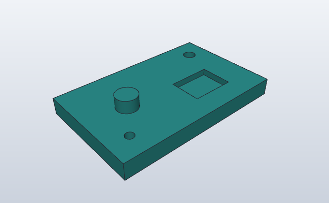
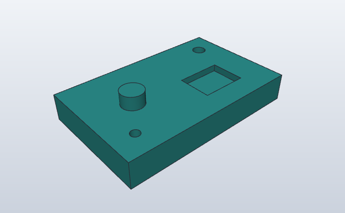

# RulerCraft

**Rebuild scanned parts you can edit in SolidCraft.**

RulerCraft turns plate-like meshes into editable CAD with named dimensions, holes, pockets, and
bosses. Use the SolidCraft plugin for mesh imports, or use RulerCraft MCP to combine point-cloud
measurements with caliper or tape readings.

[**Download the plugin**](https://github.com/flyboy-byte/rulercraft/releases/latest) ·
[Installation guide](docs/install-solidcraft-plugin.md) ·
[Use a point cloud with MCP](docs/agents-and-solidcraft.md#rebuild-a-plate-from-a-point-cloud)

| Rebuilt from the bracket STL | After editing `thickness` |
| --- | --- |
|  |  |

Both views show the [known bracket fixture](fixtures/known/bracket.stl) rebuilt by RulerCraft and
rendered in SolidCraft. Only the `thickness` parameter was changed, from 8 to 12 mm.

## Start with your input

**I have a mesh.** Install the plugin and choose **Model › Plugins group › RulerCraft**. Keep **Auto** units, then **Choose File…** and pick the
[bracket fixture](fixtures/known/bracket.stl), then change `thickness` in **Parameters**. The import
report lists what was simplified or missed and how closely the rebuild follows the input.
[Supported formats and first import](docs/install-solidcraft-plugin.md#your-first-import)

**I have a point cloud and a hand measurement.** Open the cloud in RulerCraft MCP, calibrate it
from a measured span, and pick the geometry you want to use. `assist.plate` drafts a rectangular
plate with one through or blind hole and records where its dimensions came from.
[Point-cloud walkthrough](docs/agents-and-solidcraft.md#rebuild-a-plate-from-a-point-cloud)

**I want to script it.** Build a SolidCraft project from the bracket fixture using the Rust CLI.

```sh
cargo run -p rulercraft-cli -- solidcraft fixtures/known/bracket.stl --out bracket.sc
```

[CLI and project format](docs/specs/project-file.md) · [MCP reference](docs/specs/mcp.md)

## Project status

The plugin package is tested in SolidCraft CLI on Linux. The assisted workflow has been
tested on synthetic clouds and edited in SolidCraft. Interactive desktop validation, native
assisted-rebuild integration, and validation on a physical phone capture are open.

[What is supported](docs/capabilities.md) · [Roadmap](ROADMAP.md) · [Progress](ROADMAP-PROGRESS.md) · [Test evidence](docs/specs/assisted-rebuild.md) ·
[Contributing](CONTRIBUTING.md) · [Project intent](INTENT.md)

Dual-licensed under [MIT](LICENSE-MIT) or [Apache-2.0](LICENSE-APACHE).
