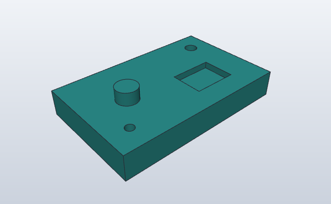

# Install RulerCraft in SolidCraft

RulerCraft opens a 3D scan in SolidCraft as an **editable part**: a plate with its holes, every size a named
parameter you can change, and a report of anything it could not rebuild. It runs inside SolidCraft, on your
machine, with no network access.

## Get the plugin

Open the [successful preview builds on main](https://github.com/flyboy-byte/rulercraft/actions/workflows/solidcraft-plugin.yml?query=branch%3Amain+is%3Asuccess).
Open the latest successful run and choose the artifact named **rulercraft-solidcraft-plugin.zip**.
It downloads the installer itself. GitHub may require sign-in. Keep the ZIP intact. It contains
`plugin.json` and `rulercraft.wasm` at its root.

The optional **rulercraft-plugin-preview** bundle includes the same installer, its checksum and
its source commit. Tagged packages appear under
[Releases](https://github.com/flyboy-byte/rulercraft/releases) when published.

1. In SolidCraft desktop, open **Preferences › Plugins › Install plugin…**.
2. Choose the inner `rulercraft-solidcraft-plugin.zip`.
3. Review the requested permissions and approve **1024 MiB of memory** if appropriate for your
   machine. SolidCraft's default plugin limit is 128 MiB. RulerCraft requests no network access.
4. Select **Install**.

From a terminal, the same with SolidCraft's command line (`--keep-plugin-approvals` makes the approval last):

```sh
solidcraft-cli exec plugin.install '{"path":"rulercraft-solidcraft-plugin.zip","dry_run":true}'
solidcraft-cli --keep-plugin-approvals exec plugin.install \
  '{"path":"rulercraft-solidcraft-plugin.zip","approve":{"memory_mib":1024}}'
```

## Your first import

1. Open or create a design and select the **Model** tab.
2. In the **Plugins** group on the ribbon, click **RulerCraft**. You can also click the group label
   **Plugins** and choose **RulerCraft…** from the menu.
3. Set **Scan units** to **Millimetres**, click **Choose File…**, and pick the
   [bracket fixture](../fixtures/known/bracket.stl). The importer accepts
   `.stl`, `.ply`, `.obj`, `.3mf`, `.gltf` and `.glb`.
4. In **Parameters**, change `thickness` from **8 mm to 12 mm** to see the rebuild update.

If RulerCraft is missing from the Model ribbon, open **Preferences › Plugins** and verify that
RulerCraft is enabled. **File › Plugins…** opens those preferences. **File › Open** uses
SolidCraft's own mesh and point-cloud readers.



- The part opens as a new, unsaved design. Change `length`, `width`, `thickness`, a `hole…_diameter`,
  `boss…_height` or `pocket…_depth` in **Parameters** and the part rebuilds. Save it as any design.
- The **Import report** lists what was not rebuilt (slanted faces such as bevels or rounds under the part, holes not square
  to the base, undercuts) and, under *From the importer*, the measured sizes, each hole's fit quality, how far the
  scan's points lie from the rebuilt part (`check`), and SolidCraft's own check: the rebuilt part's volume next to
  the scan's (`volume_check`).
- Agents connected to SolidCraft's MCP server import a scan with the same `file.import` command; see
  [agents-and-solidcraft.md](agents-and-solidcraft.md).

From a terminal: `solidcraft-cli exec file.import '{"path":"part.stl","format":"rulercraft.scan-to-part"}'`.

## What it rebuilds today

Plate-like parts: a flat base and a parallel opposite face, with any straight-edged or circular outline, rectangular
pockets, steps and pads, round bosses and pins, round holes (through, blind, counterbored or countersunk), windows cut through,
and chamfers and fillets on the top edges. All of it square to the base. Anything else (bevels or rounds under the part, slanted faces, undercuts,
curved outlines that mix arcs and lines, which become short straight edges) is listed in the report rather than
guessed. Only parts SolidCraft itself made have been tried so far; a real scan is the next test (docs/v1.md, S1). Without SolidCraft, `rulercraft solidcraft <scan> --out part.json` writes the
same design from RulerCraft's own command line.

## Remove

**Preferences › Plugins**, RulerCraft's card, **Remove**. Designs you saved keep their parts; they do not need the
plugin to open.

## When something is wrong

If SolidCraft reports **no plugin.json**, open the downloaded archive and look for
`rulercraft-solidcraft-plugin.zip` alongside `SHA256SUMS.txt`. Extract that inner ZIP and choose it
in the install dialog. Older preview downloads can have the same name as the ZIP they contain.

The report names the cause: "does not support … no face is parallel to the base" means the scan has no second
flat face to give the part a thickness. An open scan can still import. Its rebuilt volume is available if the host evaluates it, while scan volume and the difference are unavailable. Please open an issue at https://github.com/flyboy-byte/rulercraft/issues with the scan (if you can share
it) and the report (**Copy report**).
